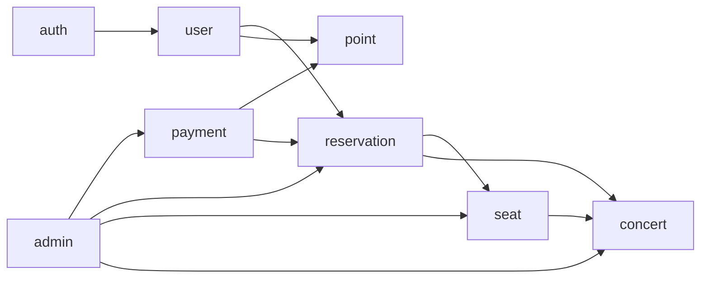

# Ticatch

콘서트 좌석 예매 백엔드다. 인기 공연의 예매가 열리는 순간 같은 좌석에 요청이 몰려도 **한 좌석은 한 사람에게만 팔리게** 하고, 몰리는 요청을 얼마나 버티는지 측정해 개선했다.

## 핵심 결과

| 문제 | 한 일 | 근거 |
| --- | --- | --- |
| 같은 좌석을 여러 명이 동시에 선점 | 좌석 행을 ID 순서로 잠근다. 잠금을 빼면 20명 중 10명이 같은 좌석을 잡는 것을 테스트로 재현했다. NOWAIT, 조건부 UPDATE, 낙관적 락과 46번 비교 측정한 뒤 이 방식을 유지했다 | [ADR 0008](docs/adr/0008-hold-seats-with-ordered-pessimistic-locks.md), [ADR 0010](docs/adr/0010-keep-ordered-pessimistic-lock-for-seat-hold.md) |
| 회차 취소와 선점·환불이 동시에 일어나면 교착 상태, 취소된 회차에 예매가 남음 | 회차 행을 취소는 배타 잠금, 선점·환불은 공유 잠금으로 먼저 잡는다. 잠금을 빼면 10번 중 4번 교착 상태, 10번 중 7번 예매가 남는 것을 재현했다 | [ADR 0009](docs/adr/0009-serialize-performance-cancel-with-performance-row-locks.md) |
| 예매 4,000건인 회차 취소에 143초, 그동안 관계없는 요청까지 실패 | 엔티티를 한 건씩 바꾸던 것을 테이블마다 UPDATE 한 문장으로 바꿨다. 4,000건 0.6초, 최대 규모 50,000건 5초 | [ADR 0011](docs/adr/0011-cancel-performance-with-set-based-updates.md) |
| 측정할 때마다 결과가 흔들림 | 측정마다 같은 데이터로 되돌리고, 끝나면 정합성을 검사하고, 비교할 방식은 번갈아 잰다 | [성능 측정 기록](docs/performance.md) |

모든 측정에서 이중 판매, 잔액 불일치 같은 정합성 위반은 0건이었다.

## 기능

**관람객**

- 회원가입, 로그인(JWT access token + 회전하는 refresh token), 탈퇴
- 포인트 충전(같은 요청을 다시 보내도 한 번만 충전)
- 공개된 공연·회차·좌석 조회
- 좌석 선점(최대 4석, 10분 안에 결제하지 않으면 자동 만료) → 포인트 결제
- 공연 시작 24시간 전까지 환불

**관리자**

- 공연장·공연·회차 등록(회차당 좌석 최대 50,000석을 한 번에 생성), 공개, 종료
- 회차 취소(그 회차의 예매를 모두 취소하고 전액 환불), 판매 현황

API 목록과 에러 코드는 [API 설계](docs/api.md)에 있다.

## 구조

기능별 모듈로 나누고, 모듈마다 `controller → service → repository → domain` 순서로만 의존한다.



| 모듈 | 하는 일 |
| --- | --- |
| `concert` | 공연장, 공연, 회차, 좌석 등급 |
| `seat` | 좌석과 판매 상태 |
| `reservation` | 좌석 선점, 선점 취소, 만료, 내 예매 |
| `payment` | 포인트 결제, 환불 |
| `point` | 지갑, 충전, 거래 내역 |
| `user`, `auth` | 회원, 로그인, 토큰 |
| `admin` | 여러 모듈에 걸친 관리자 기능(회차 등록·취소, 판매 현황) |
| `global` | 에러 응답, 보안, 페이지 처리 등 공통 기반. 업무 모듈에 의존하지 않는다 |

다른 모듈의 엔티티와 리포지토리는 쓰지 않고 서비스만 부른다. 이 규칙과 계층 방향, 모듈 사이 순환 금지는 [ArchUnit 테스트](src/test/java/com/ticatch/ArchitectureTest.java)가 빌드마다 확인한다.

## 동시성 대응

| 상황 | 대응 |
| --- | --- |
| 같은 좌석을 동시에 선점 | 좌석 행을 ID 순서로 잠근다. 여러 좌석을 엇갈린 순서로 골라도 교착 상태가 생기지 않는다 |
| 같은 회원이 같은 회차에 선점을 연달아 요청 | 결제 대기 예매는 회원·회차당 하나라는 조건부 유일 인덱스가 막는다 |
| 같은 결제·충전 요청이 두 번 옴 | 예매·지갑 행을 잠근 뒤 멱등성 키를 확인해 처음 결과를 돌려준다 |
| 결제와 만료가 동시에 일어남 | 만료 스케줄러는 잠긴 예매를 건너뛴다(`FOR UPDATE SKIP LOCKED`) |
| 회차 취소와 선점·결제·환불이 동시에 일어남 | 회차 행 잠금으로 줄을 세운다 |

모든 대응은 동시 요청을 실제로 보내는 테스트로 확인한다. 상황별 근거와 잠그는 순서는 [도메인 설계 6절](docs/domain.md#6-경합-지점)에 있다.

## 기술 스택

- Java 25, Spring Boot 4.1, Spring Data JPA, Spring Security(OAuth2 Resource Server)
- PostgreSQL 17, Flyway
- JUnit 5, Testcontainers, ArchUnit, k6
- Docker Compose, GitHub Actions

## 실행

필요한 것: JDK 25, Docker.

1. PostgreSQL을 띄운다. 데이터는 `postgres-data` 볼륨에 남는다.

   ```bash
   docker compose up -d
   ```

2. 애플리케이션을 실행한다. 처음 실행할 때 Flyway가 테이블을 만든다.

   ```bash
   ./gradlew bootRun
   ```

3. 다른 터미널에서 확인한다. `{"status":"UP"}`이 나오면 성공이다.

   ```bash
   curl http://localhost:8080/actuator/health
   ```

DB 접속 정보와 토큰 서명 키는 [application.yml](src/main/resources/application.yml)의 로컬 기본값을 쓴다. 바꾸려면 아래 환경 변수를 넣는다.

| 환경 변수 | 뜻 |
| --- | --- |
| `DB_URL`, `DB_USERNAME`, `DB_PASSWORD` | PostgreSQL 접속 정보 |
| `JWT_SECRET` | access token 서명 키. 32바이트 이상. 로컬이 아닌 곳에 띄울 때는 반드시 다른 값을 넣는다 |

## 테스트

```bash
./gradlew test
```

Testcontainers가 PostgreSQL 컨테이너를 직접 띄우므로 Docker가 실행 중이어야 한다. `docker compose`로 띄운 DB는 쓰지 않는다. 동시성 테스트는 트랜잭션을 실제로 커밋해야 경합이 재현되므로 `@Transactional` 없이 돌린다.

부하 측정은 k6로 따로 한다. 방법은 [측정 방법](perf/README.md)에 있다.

## 문서

처음 본다면 이 순서로 읽으면 된다.

1. [요구사항](docs/requirements.md): 무엇을 만드는가, 규칙은 무엇인가
2. [도메인 설계](docs/domain.md): 상태 전이, ERD, 불변식, 경합 지점과 잠금 순서
3. [ADR 0008~0011](docs/adr/README.md): 동시성에 관한 결정과 그 근거
4. [성능 측정 기록](docs/performance.md): 측정 환경, 방법, 결과

| 알고 싶은 것 | 문서 |
| --- | --- |
| API 규약, 엔드포인트, 에러 코드 | [API 설계](docs/api.md) |
| 패키지, 의존 규칙, 이름, 테스트, 커밋 | [개발 규칙](docs/conventions.md) |
| 왜 이렇게 설계했는가 (전체 목록) | [ADR](docs/adr/README.md) |
| 부하 측정을 직접 돌리려면 | [측정 방법](perf/README.md) |
