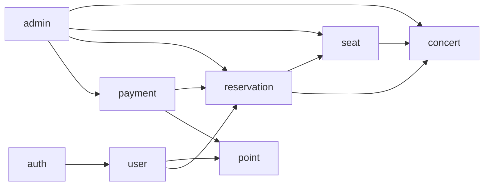
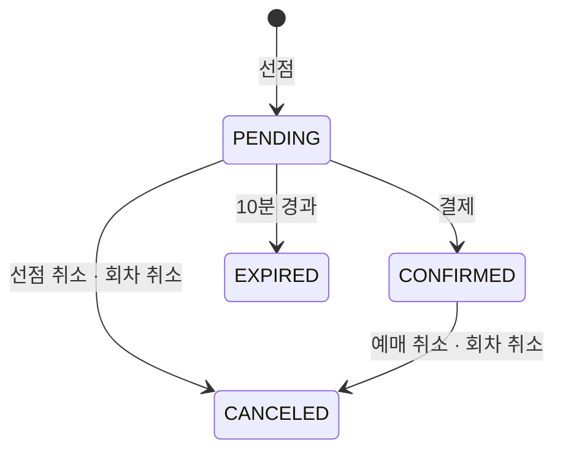
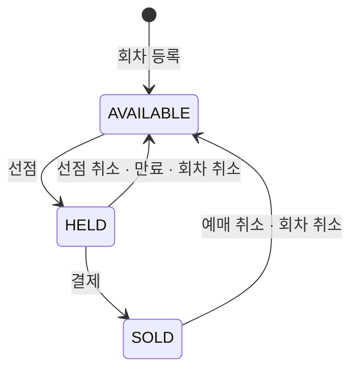
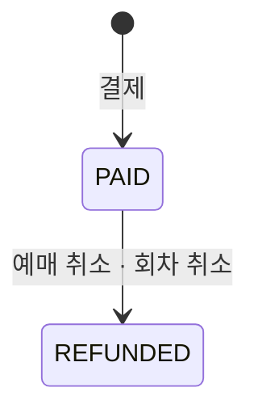
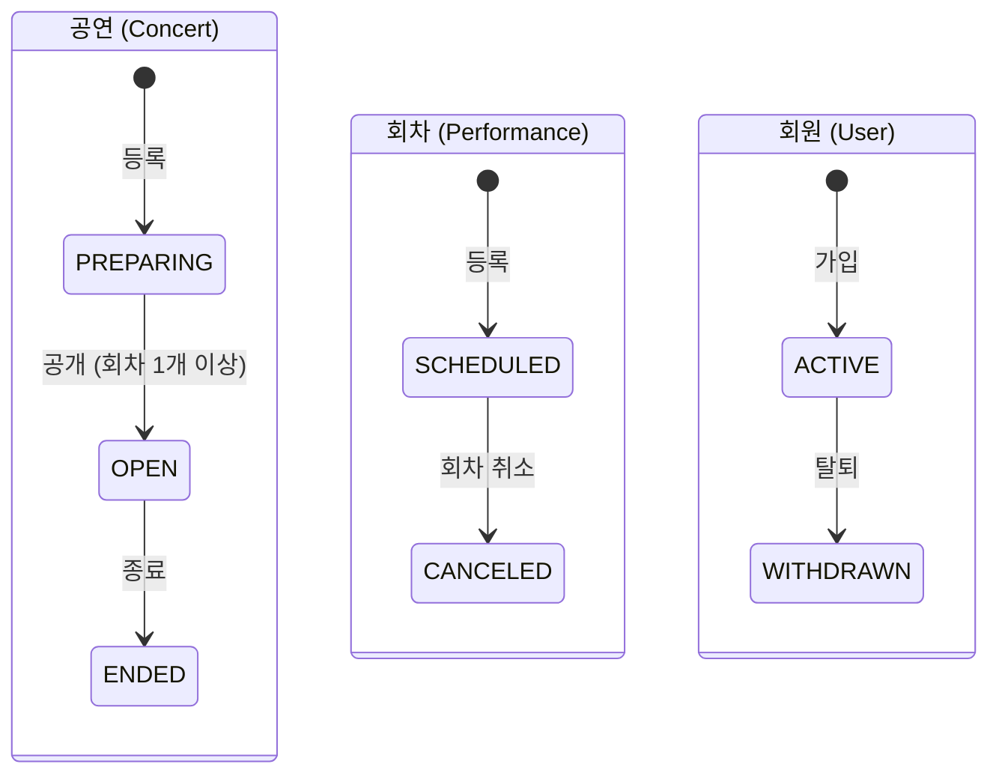
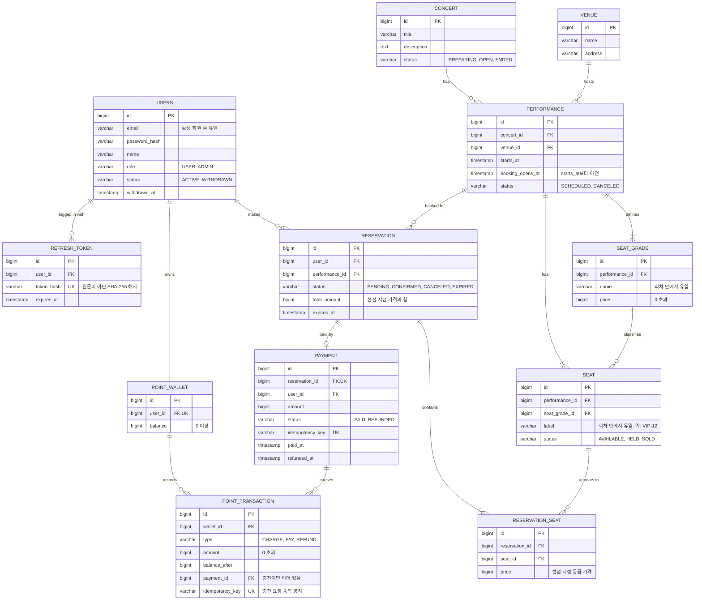

# 도메인 설계

[요구사항](requirements.md)을 코드와 테이블로 옮기기 전에 개념의 경계, 상태 변화, 지켜야 할 규칙을 정한다. 패키지 구조와 테이블 설계는 이 문서를 따른다.

## 1. 모듈과 애그리거트

모듈 하나가 최상위 패키지 하나다. 애그리거트는 "항상 함께 저장되고 함께 일관성을 지키는 묶음"이고, 루트를 통해서만 안을 바꾼다.

| 모듈 | 애그리거트 (루트 → 내부) | 책임 |
| --- | --- | --- |
| `user` | `User` | 가입, 로그인 계정, 역할, 탈퇴 |
| `auth` | `RefreshToken` | 로그인, 토큰 발급·재발급, 로그아웃 |
| `point` | `PointWallet` → `PointTransaction` | 포인트 잔액과 충전·결제·환불 거래 기록 |
| `concert` | `Concert` / `Performance` → `SeatGrade` / `Venue` | 공연, 회차, 등급별 가격, 공연장 |
| `seat` | `Seat` | 좌석 하나와 판매 상태 |
| `reservation` | `Reservation` → `ReservationSeat` | 선점, 선점 취소, 만료, 예매 확정·취소 |
| `payment` | `Payment` | 포인트 결제와 환불 |
| `admin` | 없음 | 여러 모듈을 묶는 관리자 기능 (회차 등록, 회차 취소 등) |

`admin`은 엔티티를 갖지 않는다. 회차 등록처럼 여러 모듈에 걸친 작업을 각 모듈의 서비스를 호출해 조합한다.

### 모듈 사이 참조는 ID로 한다

다른 애그리거트는 객체가 아니라 ID로 가리킨다. 예를 들어 `Reservation`은 `User` 객체가 아니라 `userId`를 가진다. 같은 애그리거트 안(`Reservation` → `ReservationSeat`)만 객체로 참조한다. 이유는 [ADR 0002](adr/0002-reference-other-aggregates-by-id.md)에 있다.

### 의존 방향

화살표는 "호출한다"는 뜻이다. 반대 방향 호출과 순환은 만들지 않는다.



- `concert`, `point`는 다른 업무 모듈을 호출하지 않는다.
- 로그인과 재발급 때 `auth`가 `user`에 회원 확인을 맡긴다. 비밀번호 해시는 `user`만 다룬다.
- 회원 가입 때 `user`가 `point`를 호출해 지갑을 만든다. 모든 회원은 지갑을 하나 가진다.
- 탈퇴 전에 `user`가 `reservation`에 진행 중인 예매가 있는지 묻는다.

## 2. 상태 전이

### 예매 (`Reservation`)



- `PENDING`일 때만 결제할 수 있다. 결제 시각이 `expires_at` 이후면 상태가 아직 `PENDING`이어도 결제를 거부한다.
- `CANCELED`, `EXPIRED`는 끝 상태다. 다시 다른 상태로 가지 않는다.

### 좌석 (`Seat`)



좌석의 상태는 항상 그 좌석을 가진 예매의 상태와 맞아야 한다. `HELD` 좌석은 `PENDING` 예매에, `SOLD` 좌석은 `CONFIRMED` 예매에 정확히 하나씩 속한다.

### 결제 (`Payment`)



MVP는 전액 환불만 한다. 부분 환불이 필요해지면 환불을 별도 엔티티로 분리한다.

### 공연·회차·회원



회차의 판매 가능 여부는 상태로 저장하지 않고 매번 계산한다. 시각이 지나면 저절로 바뀌는 값을 상태로 저장하면, 그 상태를 바꿔 줄 스케줄러가 필요하고 스케줄러가 늦을 때 값이 틀린다.

```text
판매 가능 = 공연이 OPEN
          AND 회차가 SCHEDULED
          AND booking_opens_at <= 지금 < starts_at
```

## 3. 사건별 상태 변화

한 행의 변화는 모두 **하나의 DB 트랜잭션**에서 일어난다. 일부만 반영되는 경우는 없다.

| 사건 | 예매 | 좌석 | 결제 | 포인트 |
| --- | --- | --- | --- | --- |
| 선점 | `PENDING` 생성 | `AVAILABLE` → `HELD` | | |
| 선점 취소 | `PENDING` → `CANCELED` | `HELD` → `AVAILABLE` | | |
| 만료 | `PENDING` → `EXPIRED` | `HELD` → `AVAILABLE` | | |
| 결제 | `PENDING` → `CONFIRMED` | `HELD` → `SOLD` | `PAID` 생성 | 잔액 차감, `PAY` 거래 |
| 예매 취소 | `CONFIRMED` → `CANCELED` | `SOLD` → `AVAILABLE` | `PAID` → `REFUNDED` | 잔액 증가, `REFUND` 거래 |
| 회차 취소 | 모든 `PENDING`·`CONFIRMED` → `CANCELED` | 모두 `AVAILABLE` | 모든 `PAID` → `REFUNDED` | 각 결제 금액 환불 |
| 충전 | | | | 잔액 증가, `CHARGE` 거래 |

회차가 취소되면 좌석은 `AVAILABLE`로 돌아가지만 회차가 `CANCELED`라 팔리지 않는다. 좌석 상태와 예매 상태가 항상 일치한다는 규칙을 예외 없이 지키기 위해서다.

## 4. ERD



모든 테이블에 `created_at`이 있고, 행이 바뀌는 테이블에는 `updated_at`도 있다(그림에서는 생략). 시각 컬럼은 `timestamptz`다([ADR 0005](adr/0005-store-time-as-timestamptz-and-instant.md)).

### 설계 포인트

- **좌석 등급을 테이블로 분리했다.** 이전 버전은 좌석마다 가격을 저장하고 등급을 `enum`으로 고정했다. 등급 이름과 가격은 회차마다 다르므로 `SEAT_GRADE`가 갖고, 좌석은 등급을 가리킨다.
- **금액은 선점할 때 복사해 둔다.** `RESERVATION_SEAT.price`와 `RESERVATION.total_amount`는 그 시점의 등급 가격이다. 나중에 가격이 바뀌어도 결제·환불 금액이 바뀌지 않는다.
- **포인트를 회원 테이블에서 분리했다.** 잔액은 결제·환불·충전 때마다 바뀌는 값이다. 회원 행에 두면 결제 중 잠금이 프로필 수정까지 막는다. 지갑은 잔액을, 거래 테이블은 모든 변화를 기록한다. 잔액은 거래 금액을 모두 더한 값과 항상 같아야 한다.
- **회원은 지우지 않는다.** 탈퇴는 `status = WITHDRAWN`으로 표시한다(소프트 삭제). 결제 기록이 회원을 가리키기 때문이다.
- **DB 외래 키는 둔다.** 코드는 다른 애그리거트를 ID로 참조하지만, 테이블에는 외래 키 제약을 걸어 존재하지 않는 ID가 들어가는 것을 막는다.

## 5. 불변식과 지키는 곳

불변식은 "어떤 순간에도 깨지면 안 되는 규칙"이다. 두 곳에서 지킨다.

- **도메인 코드**: 먼저 검사해 사용자에게 의미 있는 에러를 돌려준다.
- **DB 제약**: 동시 요청이 코드의 검사를 동시에 통과해도 마지막에 막는다.

DB로 표현할 수 있는 규칙은 코드에서 검사하더라도 DB에도 건다.

| # | 불변식 | 도메인 코드 | DB |
| --- | --- | --- | --- |
| 1 | 한 좌석은 동시에 한 예매에만 선점·판매된다 | `AVAILABLE` 좌석만 `HELD`로 바꾼다 | 조건부 갱신 또는 락. [ADR 0003](adr/0003-seat-row-owns-sales-state.md), 구현 단계에서 확정 |
| 2 | 회원·회차당 결제 대기 예매는 하나 | 선점 전에 확인 | 조건부 유일 인덱스 `(user_id, performance_id) WHERE status = 'PENDING'` |
| 3 | 한 예매의 좌석은 1~4석 | 선점 요청 검증 | |
| 4 | 포인트 잔액은 0 이상 | 차감 전에 확인 | `CHECK (balance >= 0)` |
| 5 | 잔액 = 거래 금액의 합 | 잔액과 거래를 같은 트랜잭션에서 바꾼다 | 테스트로 검증 |
| 6 | 예매당 결제는 하나 | 결제 전에 예매 상태 확인 | `UNIQUE (reservation_id)` |
| 7 | 같은 결제 요청은 한 번만 처리 | 멱등성 키로 이전 결과를 돌려준다 | `UNIQUE (payment.idempotency_key)` |
| 8 | 같은 충전 요청은 한 번만 처리 | 멱등성 키로 이전 결과를 돌려준다 | `UNIQUE (point_transaction.idempotency_key)` |
| 9 | 결제당 차감·환불 거래는 각각 한 번 | 결제 상태 확인 | `UNIQUE (payment_id, type)` |
| 10 | 좌석 상태와 예매 상태가 일치한다 | 같은 트랜잭션에서 함께 바꾼다 | 테스트로 검증 |
| 11 | 회차 안에서 좌석 이름·등급 이름은 유일 | | `UNIQUE (performance_id, label)`, `UNIQUE (performance_id, name)` |
| 12 | 예매 오픈은 공연 시작보다 앞선다 | 회차 등록 때 검증 | `CHECK (booking_opens_at < starts_at)` |
| 13 | 가격과 금액은 0보다 크다 | 등록 때 검증 | `CHECK (price > 0)`, `CHECK (amount > 0)` |
| 14 | 활성 회원의 이메일은 유일 | 가입 때 확인 | 조건부 유일 인덱스 `(email) WHERE status = 'ACTIVE'` |

2번과 14번의 조건부 유일 인덱스가 [ADR 0001](adr/0001-use-postgresql.md)에서 PostgreSQL을 고른 이유다.

## 6. 경합 지점

동시에 요청이 들어올 때 규칙이 깨질 수 있는 곳이다. 구현 단계에서 각각 테스트로 재현한 뒤 대응을 확정한다.

| # | 상황 | 깨질 수 있는 규칙 | 대응 방향 |
| --- | --- | --- | --- |
| 1 | 여러 명이 같은 좌석을 동시에 선점 | 1 | 좌석 행 비관적 락([ADR 0008](adr/0008-hold-seats-with-ordered-pessimistic-locks.md)). `ReservationConcurrencyTest`로 확인했다. 7단계에서 NOWAIT, 조건부 UPDATE, 낙관적 락과 측정·비교한 뒤 유지했다([ADR 0010](adr/0010-keep-ordered-pessimistic-lock-for-seat-hold.md)) |
| 2 | A는 1·2번, B는 2·1번 좌석을 동시에 선점 | 교착 상태(deadlock) | 좌석을 항상 ID 오름차순으로 잠근다. `ReservationConcurrencyTest`로 확인했다 |
| 3 | 같은 회원이 같은 회차에 선점 요청을 연달아 보냄 (더블 클릭) | 2 | 조건부 유일 인덱스가 두 번째 요청을 막는다. `ReservationConcurrencyTest`로 확인했다 |
| 4 | 만료 처리와 결제가 동시에 일어남 | 10 | 결제는 예매 행을 잠그고, 만료 스케줄러는 `FOR UPDATE SKIP LOCKED`로 잠긴 예매를 건너뛴다. 둘 중 하나만 반영된다. `PaymentConcurrencyTest`로 확인했다 |
| 5 | 같은 결제 요청이 두 번 옴 | 6, 7 | 예매 행을 잠근 뒤 멱등성 키를 확인해, 나중 요청은 처음 결과를 받는다. 유일 제약이 마지막에 막는다. `PaymentConcurrencyTest`로 확인했다 |
| 6 | 같은 회원의 결제와 충전이 동시에 일어남 | 4, 5 | 지갑 행을 `SELECT ... FOR UPDATE`로 잠그고 바꾼다. `PointConcurrencyTest`, `PaymentConcurrencyTest`로 확인했다 |
| 7 | 예매 취소 요청이 두 번 옴 | 9 | 결제 행을 잠그고 환불 상태 전이를 한 번만 성공하게 한다. 유일 제약 `(payment_id, type)`이 마지막에 막는다 |
| 8 | 회차 취소와 선점·결제·환불이 동시에 일어남 | 10, 교착 상태 | 회차 취소는 회차 행을 배타 잠금으로, 선점과 환불은 공유 잠금으로 먼저 잡는다([ADR 0009](adr/0009-serialize-performance-cancel-with-performance-row-locks.md)). `PerformanceCancelConcurrencyTest`로 확인했다 |

### 잠금 순서

여러 행을 잠그는 작업은 아래 순서를 지킨다. 모든 작업이 같은 순서로 잠그면 서로를 기다리는 교착 상태가 생기지 않는다.

```text
회차  →  결제·예매  →  좌석(ID 오름차순)  →  지갑
```

| 작업 | 잠그는 순서 |
| --- | --- |
| 선점 | 회차(공유) → 자기 결제 대기 예매 → 좌석 |
| 선점 취소, 만료 | 예매 → 좌석 |
| 결제 | 예매 → 좌석 → 지갑 |
| 환불 | 회차(공유) → 결제 → 예매 → 좌석 → 지갑 |
| 충전 | 지갑 |
| 회차 취소 | 회차(배타) → 예매 → 좌석 → 결제 → 지갑(회원 ID 오름차순) |

회차 취소만 예매를 결제보다 먼저 바꾼다. 회차 취소가 회차 행을 배타 잠금으로 쥔 동안에는 결제 행을 잠그는 환불이 회차 잠금에서 기다리므로 순서가 엇갈려도 교착 상태가 생기지 않는다. 공유 잠금끼리는 서로 막지 않아 평소의 선점·환불은 회차 잠금 때문에 기다리지 않는다. 회차 취소는 예매·좌석·결제를 테이블마다 UPDATE 한 문장으로 바꾸므로 행 안의 순서는 정하지 않는다. 그래도 교착이 생기지 않는 이유는 [ADR 0011](adr/0011-cancel-performance-with-set-based-updates.md)에 있다.

## 7. 받아들인 한계

- **만료된 좌석은 최대 스케줄러 주기(30초)만큼 늦게 풀린다.** 만료의 정확성은 결제할 때 `expires_at`을 비교해서 지킨다. 스케줄러는 좌석을 돌려놓는 역할만 하므로, 늦어도 규칙은 깨지지 않고 좌석이 잠깐 덜 보일 뿐이다.
- **회차 취소는 한 트랜잭션이라, 그동안 그 회차 회원들의 지갑이 잠긴다.** 처음에는 예매를 한 건씩 엔티티로 바꿔 확정 예매 4,000건에 143초가 걸렸고, 그동안 지갑 잠금을 기다리는 요청이 DB 커넥션을 모두 차지해 관계없는 요청까지 실패했다. 테이블마다 UPDATE 한 문장으로 바꿔 최대 규모(50,000건)도 5초에 끝나게 했다([ADR 0011](adr/0011-cancel-performance-with-set-based-updates.md), [성능 측정 기록 5절](performance.md#5-회차-취소-개선-2026-11-18)). 그래도 50,000건 취소 중에는 그 회원들의 충전이 최대 2.4초 기다린다. 나눠서 비동기로 처리하는 방식은 이 시간이 문제가 될 때 다시 검토한다.
